# YourEnergy — Fitness Exercises Web App

> Team educational project by **Code Masters** · GoIT Fullstack Developer
> program

**YourEnergy** is a responsive multi-page web application that helps users find
exercises for their workouts. Users can browse exercises by muscle group, body
part or equipment, search by keyword, view detailed exercise info, rate
exercises, save favorites and subscribe to the newsletter.

🔗 **Live demo:**
[vhromyk.github.io/project-code-masters](https://vhromyk.github.io/project-code-masters/)

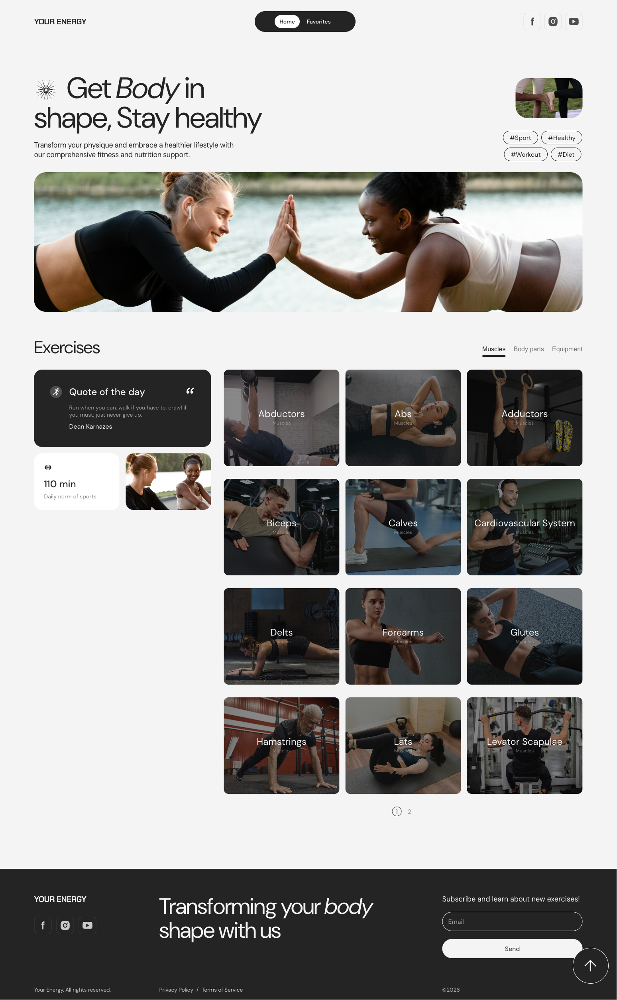

---

## Table of Contents

- [About the Project](#about-the-project)
- [Features](#features)
- [Tech Stack](#tech-stack)
- [Screenshots](#screenshots)
- [Project Structure](#project-structure)
- [API](#api)
- [Getting Started](#getting-started)
- [Team](#team)
- [Workflow](#workflow)

---

## About the Project

YourEnergy was built by a team of developers as part of the GoIT Fullstack
Developer program. We built it the way a commercial project is built: from a
Figma design and a technical specification, with tasks split between team
members, Git Flow, pull requests, code review, and a production build deployed
through GitHub Actions.

The specification has two parts:

- **MVP (base version):** the required functionality. We implemented all of it.
- **Additional features:** optional tasks the team could take on only after the
  MVP was done. We implemented all of them too (rating, loader and scroll-up).

**Key goals:**

- Pixel-perfect layout that follows the Figma design
- Responsive, mobile-first layout for **mobile, tablet and desktop**
- Work with a REST API (`GET`, `POST` and `PATCH` requests) using server-side
  pagination
- Clean, modular TypeScript code without frameworks
- Retina-ready images (`@1x` / `@2x`) and SVG icons from a sprite
- Basic accessibility: semantic HTML, `aria` attributes, and keyboard support in
  modals

---

## Features

### MVP

#### Header

- **Mobile:** logo and a burger menu that opens to the full viewport height,
  with navigation and social links
- **Tablet and desktop:** logo, navigation and social links
- Clicking the logo or **Home** opens the home page, and clicking **Favorites**
  opens the favorites page
- Social links are a `<ul>` list with SVG icons that open GoIT's Facebook,
  Instagram and YouTube pages in a new tab

#### Home page

- **Hero** with static content: the site title, a subtitle, popular tags and
  images
- **Filters panel** with the `Muscles`, `Body parts` and `Equipment` buttons.
  Clicking a filter requests its categories from the backend and highlights that
  button as active. `Muscles` is selected by default.
- **Category cards** with an image, a name and a filter type. Clicking a card
  hides the categories and shows the exercises in that category.
- **Exercises list.** The section title shows the selected category, and a
  search field appears next to the filters.
- **Search** that takes into account the filter, the category, the keyword
  (applied on submit), the page size and the page number
- **Server-side pagination**, with the page number and the page size sent as
  request parameters
- **Exercise card** with the name, the calories burned in 3 minutes, the body
  part, the target and the rating, plus a **Start** button that opens the
  exercise modal
- **Quote of the Day**, fetched from the backend and cached in `localStorage`
  together with the date. A new request is made only when the date changes.
- An info block about why 110 minutes of daily sport matters
- Messages for when the backend returns no categories or no exercises

#### Exercise modal

- GIF or video demonstration, name, rating, target, body part, popularity,
  calories burned in 3 minutes and a short description
- **Add to favorites / Remove from favorites** button that keeps the favorites
  list in sync with `localStorage`
- Closes on a backdrop click, on the close button or on `Esc`, and removes its
  event listeners when it closes

#### Favorites page

- Quote of the Day and an info block about daily sport
- A list of the exercises the user saved to `localStorage`
- An exercise card with a **Start** button and a trash button that removes the
  exercise from favorites without reloading the page
- A message for when no favorites have been added

#### Footer

- Logo that links to the home page, social links and the company slogan
- **Newsletter subscription** form with a required email field that is validated
  with `pattern="^\w+(\.\w+)?@[a-zA-Z_]+?\.[a-zA-Z]{2,3}$"`. A valid email is
  sent to the backend, and the response (success, invalid email, already
  subscribed or network error) is shown to the user.

### Additional features

- **Add rating:** a **Give a rating** button in the exercise modal opens a
  rating form with star radio buttons, a required email and a comment, all of
  them required fields. Opening the rating form closes the exercise modal, and
  closing the rating form reopens it. On a successful backend response the form
  closes, and on an error the user sees a notification with the error text.
- **Scroll up:** a button that scrolls back to the top of the page
- XSS-safe rendering of API data

---

## Tech Stack

| Category      | Technologies                                                      |
| ------------- | ----------------------------------------------------------------- |
| Markup        | HTML5 (partials via `vite-plugin-html-inject`)                    |
| Styles        | CSS3, CSS custom properties, mobile-first media queries, PostCSS  |
| Language      | TypeScript                                                        |
| Build tool    | Vite                                                              |
| HTTP          | Axios (shared instance + centralized endpoints)                   |
| Storage       | `localStorage` (favorites, quote of the day)                      |
| Deployment    | GitHub Pages + GitHub Actions                                     |
| Code style    | Prettier, EditorConfig                                            |
| Collaboration | Git, GitHub (feature branches, pull requests, code review), Figma |

---

## Screenshots

### Home page

| Desktop                                              | Tablet                                             | Mobile                                             |
| ---------------------------------------------------- | -------------------------------------------------- | -------------------------------------------------- |
|  | 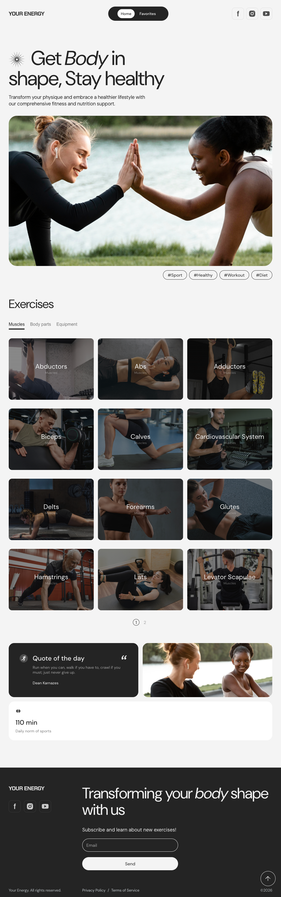 | 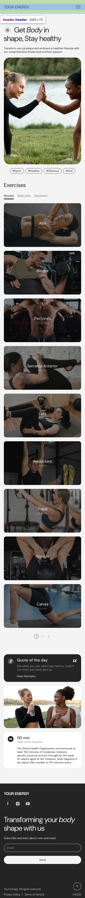 |

### Categories and exercises

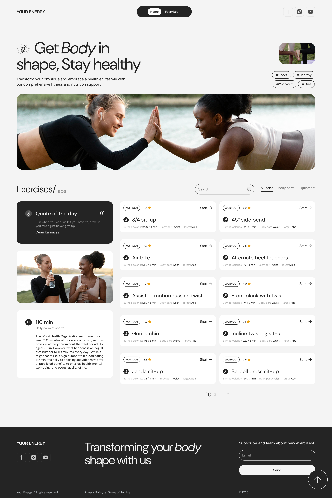

### Search

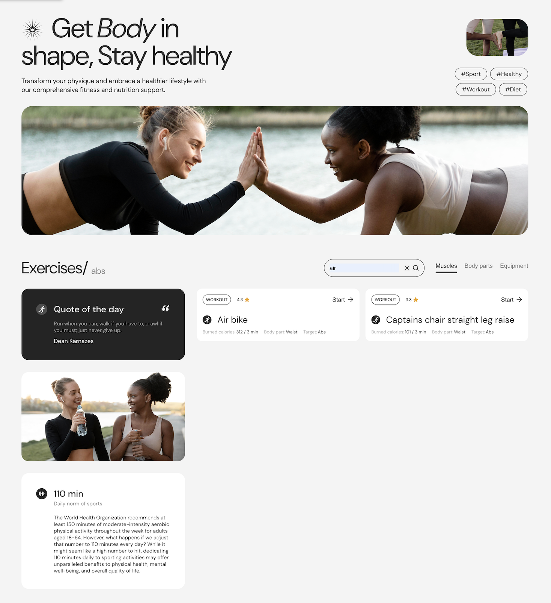

### Exercise modal and rating form

| Exercise details                                         | Rating form                                        |
| -------------------------------------------------------- | -------------------------------------------------- |
| 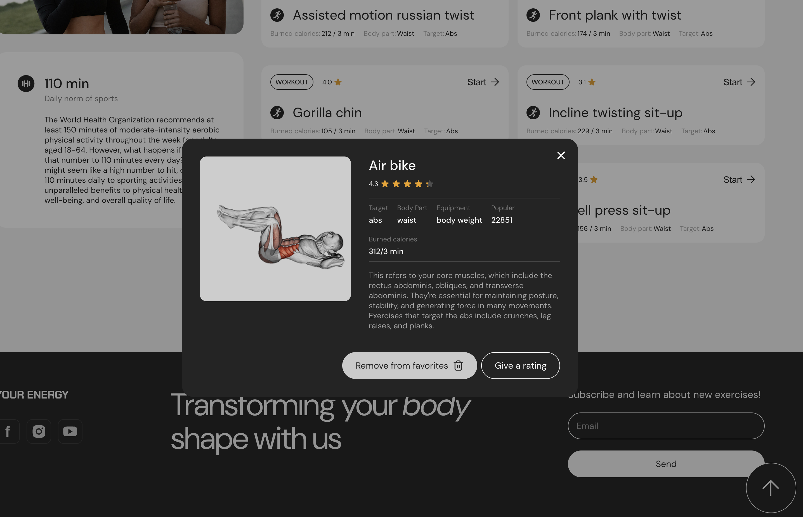 | 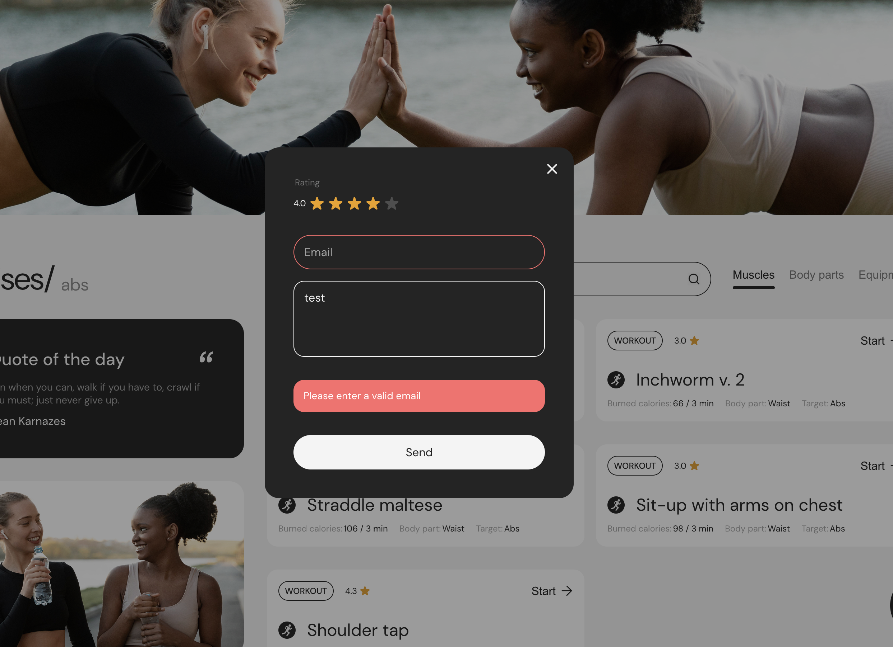 |

### Favorites

| With exercises                                 | Empty state                                                |
| ---------------------------------------------- | ---------------------------------------------------------- |
| 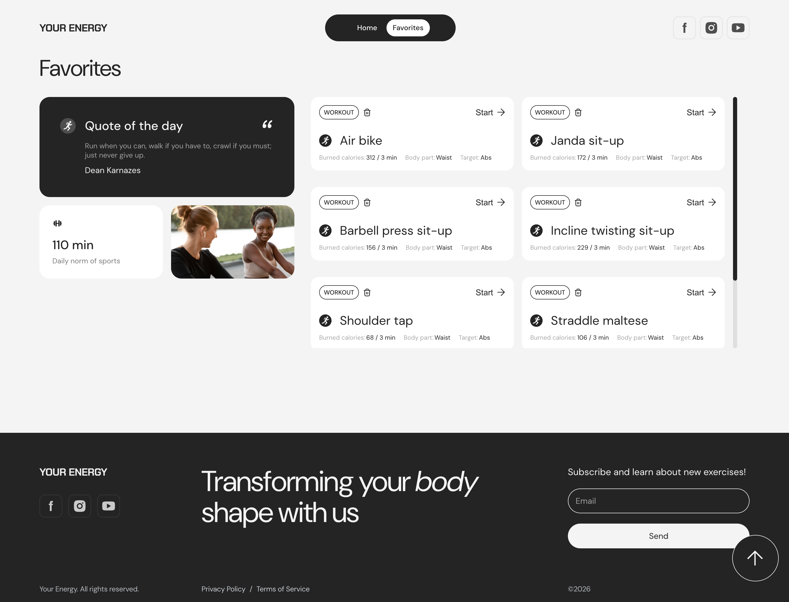 | 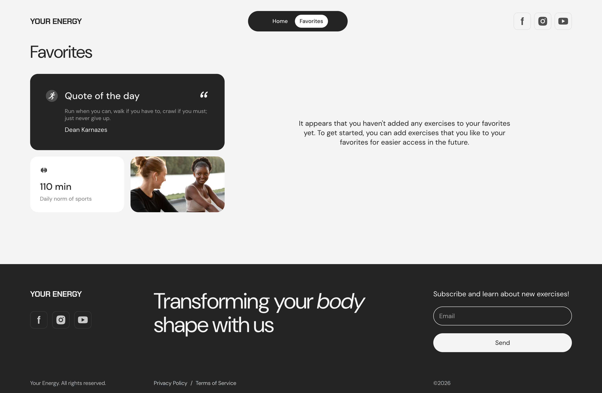 |

### Mobile menu and subscription

| Mobile menu                                        | Subscription                                         |
| -------------------------------------------------- | ---------------------------------------------------- |
| 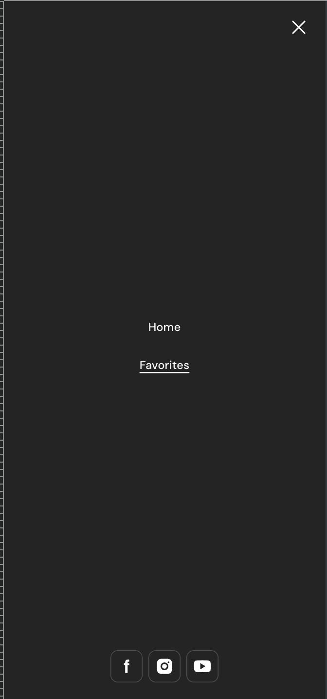 | 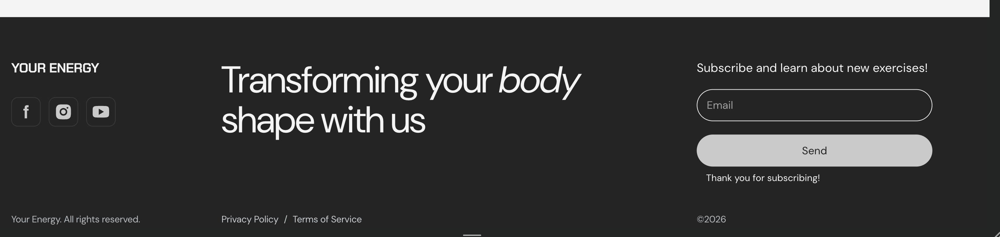 |

---

## Project Structure

```
src/
├── api/
│   ├── config/endpoints.ts   # API endpoints
│   ├── http.ts               # Axios instance (baseURL, timeout)
├── css/                      # Styles split by section/component
├── img/                      # Images (@1x/@2x), SVG sprite
├── partials/                 # HTML sections (header, hero, filters, ...)
├── ts/
│   ├── add-to-favorites/     # Favorites storage and button logic
│   ├── exercises/            # Exercise cards, pagination, favorites page
│   ├── filters/              # Filters state and events
│   ├── popup/                # Exercise modal, rating form, validation
│   ├── templates/            # Card templates
│   ├── types/                # TypeScript types
│   ├── utils/                # Helpers (escape HTML, card limit)
│   ├── header.ts
│   ├── quote.ts
│   ├── subscription.ts
│   └── scroll-up.ts
├── index.html                # Home page
└── favorites.html            # Favorites page
```

---

## API

Base URL: `https://your-energy.b.goit.study/api` ·
[API docs (Swagger)](https://your-energy.b.goit.study/api-docs)

| Method  | Endpoint                 | Description                                                                |
| ------- | ------------------------ | -------------------------------------------------------------------------- |
| `GET`   | `/filters`               | Categories by filter (`filter`, `page`, `limit`)                           |
| `GET`   | `/exercises`             | Exercises (`bodypart`, `muscles`, `equipment`, `keyword`, `page`, `limit`) |
| `GET`   | `/exercises/{id}`        | Exercise details                                                           |
| `PATCH` | `/exercises/{id}/rating` | Rate an exercise                                                           |
| `GET`   | `/quote`                 | Quote of the day                                                           |
| `POST`  | `/subscription`          | Newsletter subscription                                                    |

---

## Getting Started

**Requirements:** Node.js LTS

```bash
# Clone the repository
git clone https://github.com/VHromyk/project-code-masters.git
cd project-code-masters

# Install dependencies
npm install

# Run dev server (http://localhost:5173)
npm run dev

# Production build
npm run build

# Preview the build
npm run preview
```

Every push to `main` triggers a GitHub Actions workflow that builds the project
and deploys it to GitHub Pages.

---

## Team

| Member                                                | Role         | Contribution                                                        |
| ----------------------------------------------------- | ------------ | ------------------------------------------------------------------- |
| [Vitalii Hromyk](https://github.com/VHromyk)          | Team Lead    | Project setup, header, Axios instance, folder architecture, reviews |
| [Ruslan Mirasov](https://github.com/RuslanMirasov)    | Developer    | Exercise modal, add to favorites, rating form, refactoring          |
| [Ilona Gil](https://github.com/Gilona-itsme)          | Developer    | Exercise cards, exercise list with pagination, Favorites page       |
| [Mykola Yanchev](https://github.com/m-yanchev)        | Developer    | Filters block, search, filter state                                 |
| [Alex Shokotko](https://github.com/)                  | Scrum Master | Favorites feature, scroll-up, loaders, layout fixes                 |
| [Mariia](https://github.com/MariiaMariiaMariya)       | Developer    | Responsive categories, search and pagination                        |
| [Liudmyla Lytvynova](https://github.com/zwazoo)       | Developer    | Quote of the Day section                                            |
| [Ali Burzhi](https://github.com/aliburzhi)            | Developer    | Hero section, scroll-up button                                      |
| [Oleksandr Shypilov](https://github.com/ashypilovdev) | Developer    | Footer                                                              |
| [Volodymyr Sirash](https://github.com/volvyas)        | Developer    | Category card                                                       |

---

## Workflow

- Tasks were split between team members according to the technical specification
- Each feature was developed in a separate branch (`feature/*`, `bugfix/*`)
- Changes were merged into `main` only through **pull requests** after code
  review
- Shared conventions: HTML partials, global CSS variables in `styles.css`
  (`--color-*`, `--radius-*`), SVG sprite for icons, common Axios instance and
  endpoints

---

## License

This project was created for educational purposes as part of the
[GoIT](https://goit.global/) program.
